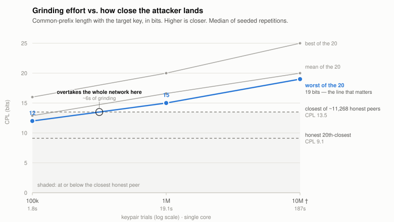
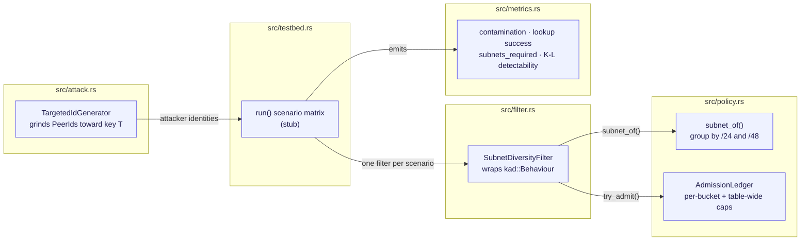
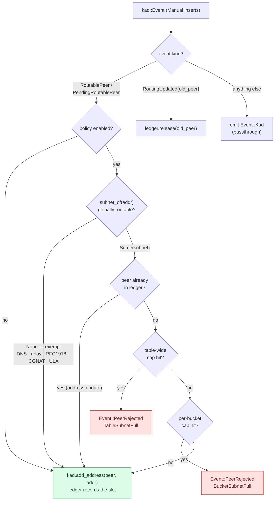

# kad-eclipse-testbed

An adversarial measurement harness for Kademlia routing-table policy: what an
eclipse attack costs, and what each defence raises that cost to. It uses
rust-libp2p as a realistic substrate.

**It is not a test suite, and it does not overlap rust-libp2p's.** Their 77 kad
tests ask whether the implementation behaves correctly — including against a
scripted adversary, which two of them do. This asks what an attack costs at
population scale. A test has a pass/fail oracle; a measurement has an error bar.
Neither is a better-stocked version of the other.

> **Status: Phase 1 complete.** The crate builds and `make all` is green —
> `cargo fmt`, `cargo clippy -- -D warnings` and all 20 tests pass against
> `libp2p 0.57` / `libp2p-kad 0.49`. `testbed::run` is still a stub. Not
> published to crates.io, deliberately.
>
> **Result:** [`docs/results/2026-10-19-grind.json`](docs/results/2026-10-19-grind.json)
> — 10/10/5 seeded repetitions, medians with IQR and achieved standard error,
> generated by `scripts/phase1_grind.py`.
>
> **In 19 seconds of one core on a slow cloud vCPU, all twenty ground
> identities land closer to a chosen key than every one of the Amino DHT's
> ~11,268 honest peers.** The worst of the twenty sits at CPL 15.0 (IQR
> [15.0, 15.0]); the *closest* honest peer is expected at CPL 13.5. At 1.8
> seconds the twenty already displace the honest closest-20 set. Targeted
> placement is not merely cheap — it is free, and the defence has to act on
> placement because nothing acts on minting.

<picture>
  <source media="(prefers-color-scheme: dark)" srcset="docs/images/phase1-crossover-dark.svg">
  
</picture>

*Generated from the committed result file by `scripts/mkchart.py`, including the
crossover annotation — the picture cannot drift from the data.*

| trials | time | mean CPL of kept 20 | 20th-best | best |
|---|---|---|---|---|
| 100,000 | 1.8 s | 12.88 | 12.0 | 16.0 |
| 1,000,000 | 19.1 s | 16.60 | 15.0 | 20.0 |
| 10,000,000 † | 187 s | 20.00 | 19.0 | 25.0 |

Honest baseline for ~11,268 uniformly distributed peers: closest peer CPL
**13.5**, 20th-closest **9.1**. † provisional — see
[`docs/results/README.md`](docs/results/README.md) for why, and why `best` is
the column not to quote.

## What this is for

Three libp2p implementations have made three different choices about
routing-table address diversity, and not one of them is backed by a published
measurement. go-libp2p has shipped `peerdiversity` inside `go-libp2p-kbucket`
for years, grouping IPv4 by /16. py-libp2p merged per-subnet caps in
[#1399][1399] at /24. rust-libp2p has nothing at the address level.

rust-libp2p *has* shipped the other S/Kademlia counter — disjoint lookup paths,
since v0.20.0 — and tests it adversarially: `s_kademlia_disjoint_paths` scripts
a malicious response returning peers closer than the honest ones, and
`disjoint_query_does_not_finish_before_all_paths_did` runs three real swarms
with an adversary among them. Two issues proposing further Sybil defences,
[#4769][4769] and [#1352][1352], closed without one landing. The public threads
don't record a single reason for either, so this repository doesn't guess at
one.

The gap is not that nobody has proposed a defence, and not that nobody cares.
It is that nobody has published a number — for the attack, or for any of the
defences.

This repository exists to produce that number. The reference filter in
`src/filter.rs` is here so the testbed has something to measure — it is
explicitly **not** a library for other crates to depend on, and it says so in
its own docs.

## The state of play

| | go-libp2p | py-libp2p | rust-libp2p |
|---|---|---|---|
| Disjoint lookup paths | parallel but not disjoint | missing | present, opt-in, off by default |
| IP/subnet diversity in k-buckets | shipped, /16 | shipped, /24 ([#1399][1399]) | **missing** |
| Adversarial tests for either | — | simulation only | yes — 2, on disjoint-path correctness |
| Published cost measurement | **none** | **none** | **none** |

The last row is the gap this repository exists to close. Phase 1 closes the
attack side of it; the defence side needs Phase 4. The go-libp2p disjoint-path
entry follows [arXiv:2505.01139][arxiv], which finds Kubo issues parallel
queries but aggregates results into one structure rather than keeping paths
disjoint.

## The questions

Pre-registered in [`docs/methodology.md`](docs/methodology.md), written before
any measurement exists so that nobody — including the author — can tune the
experiment until it says something convenient.

1. **Does a subnet cap reduce contamination of the victim's k-closest set?**
2. **How many distinct subnets must an attacker rent to undo it?** This is the
   number that converts to money, since identities are free and address
   diversity is not.
3. **What fraction of honest peers does it wrongly reject?** A defence that
   locks out legitimate peers behind large ISPs is not shippable regardless of
   how well it scores on the first two.

There is also a standing disagreement worth settling: go-libp2p groups IPv4 by
/16, py-libp2p by /24. Nobody has published a comparison. `--prefix-v4` sweeps
it.

**What would falsify the hypothesis** is stated up front in the methodology, and
a negative result gets published the same as a positive one.

## How to use this

**What works today is the attack side.** `grind` measures it, and
`scripts/phase1_grind.py` turns that into a result file. `run` — the scenario
matrix that measures the *defences* — is a stub that exits non-zero; that is
Phase 4. Nothing here is published to crates.io, and there is no reason to
depend on it as a library: this is a repository you clone and run.

```sh
git clone https://github.com/yashksaini-coder/kad-eclipse-testbed
cd kad-eclipse-testbed
cargo build --release
```

**Reproduce the headline number** — how long until twenty ground identities all
beat every honest peer:

```sh
cargo run --release -- grind --trials 1000000 --keep 20 --seed 1
```

**Regenerate the committed result** (10/10/5 repetitions, ~16 min; `PLAN`
shortens it):

```sh
make results                               # writes docs/results/<today>-grind.json
make results PLAN=--plan=100000:5          # quick version
python3 scripts/mkchart.py docs/results/<file>.json docs/images   # redraw the chart
```

**Feed it into something else** — `--json` emits the seed and the CPL of every
kept identity, so the grinder is usable as a measurement primitive without
touching the Rust:

```sh
cargo run --release -- grind --trials 100000 --seed 42 --json | jq '.kept[].cpl'
```

**Point it at your own network.** The honest baseline in the result file assumes
the Amino DHT's ~11,268 peers. If you run a different Kademlia network,
`AMINO_PEERS` in `scripts/phase1_grind.py` is the one number to change — the
comparison is `log2(N)` for the closest honest peer and `log2(N/20)` for the
20th.

**What does not work yet:**

```sh
cargo run --release -- run --scenario all     # Error: testbed::run is not implemented yet
```

### If you only want the finding

Read [`docs/results/README.md`](docs/results/README.md). Every number there has
a committed JSON file behind it, and the file records the seeds, so you can
re-derive any of it rather than trusting the table.

## Layout

```
src/
  attack.rs      TargetedIdGenerator — grinds peer IDs toward a key
  policy.rs      subnet grouping, global-routability, AdmissionLedger
  filter.rs      SubnetDiversityFilter — reference impl, NOT a stable API
  metrics.rs     five metrics incl. K-L eclipse detectability
  testbed.rs     five-scenario matrix (run() is a stub)
  main.rs        CLI
docs/
  methodology.md  pre-registered protocol, controls, falsification criteria
  threat-model.md attacker model, why signing and disjoint paths don't close it
  repo-setup.md   branch rules and one-time gh commands
```

## How it fits together



## Why the filter is not the product

`SubnetDiversityFilter` wraps `kad::Behaviour` and is driven by the event
semantics of `BucketInserts::Manual`. Those semantics are *documented* — kad's
own rustdoc says that under `Manual` peers enter the table only via
`add_address`, and that `RoutablePeer` means the peer "has not been added." So
this is public API, not something reverse-engineered.

Two things still keep it from being a foundation for other crates. Documented
behaviour is not a stability guarantee, and a change here would not fail to
compile — the types stay identical while the meaning moves, which is the worst
failure mode a security component has (hence `libp2p` being held back from
automated dependency bumps). And `RoutablePeer` fires for two distinct reasons,
`Manual` being configured *or* the bucket being full, so the event alone does
not tell you which.

The admission decision it makes on every peer, under `BucketInserts::Manual`:



Rejection is refusal of a routing-table *slot*, never an eviction of a resident
peer — the reject-don't-evict semantics py-libp2p #1399 also ships.

The durable version of this belongs behind an explicit hook inside
`libp2p-kad`, the way go-libp2p put `peerdiversity` inside the kbucket package
rather than wrapping it from outside. Whether such a hook is in scope is a
question for the maintainers, and the right time to ask is after there are
numbers — not before.

## Who this is for

The primary customer is **py-libp2p**, not rust-libp2p.

py-libp2p ships `MAX_PEERS_PER_SUBNET = 2`, `/24`, `/48` ([#1399][1399]) and a
table-wide cap defaulting to `0` (#1442). go-libp2p uses `/16` and
`maxForTable=3`. This repository's scaffold picked `6`. Three implementations,
three answers, and no measurement behind any of them.

rust-libp2p is option value, not the thesis: nothing here is sequenced behind an
upstream decision, and no claim here depends on one being made. `libp2p-kad`
moved 0.48.0 → 0.49.0 in `libp2p 0.57`, which this crate builds against.

## Roadmap

Full version with exit criteria and kill conditions in
[`docs/dev-plan.md`](docs/dev-plan.md). Phases are ordered by value per unit of
effort, not by dependency — the most valuable measurement here does not need
the testbed to exist.

0. Make it compile.
1. The premise number: how fast can a laptop grind a full k-bucket of targeted
   identities?
2. **Honest-peer rejection against the real Amino DHT** — a crawl snapshot
   grouped by subnet answers Q3 directly, with no Rust involved. Cheapest
   phase, highest value, and the one most likely to find a bug in already-
   merged py-libp2p code.
3. Cross-implementation conformance vectors for subnet grouping.
4. The in-memory testbed. The expensive phase, deliberately last-but-one.
5. Full matrix, statistics, and the /16-vs-/24 sweep.
6. Publish — py-libp2p defaults first, rust-libp2p question last.

## Related work by the author

- [py-libp2p #1399][1399] — IP subnet diversity in Kademlia k-buckets (merged)
- py-libp2p #1442 — configurable and table-wide subnet limits (in review)

## License

MIT OR Apache-2.0

[4769]: https://github.com/libp2p/rust-libp2p/issues/4769
[1352]: https://github.com/libp2p/rust-libp2p/issues/1352
[1399]: https://github.com/libp2p/py-libp2p/pull/1399
[arxiv]: https://arxiv.org/abs/2505.01139
